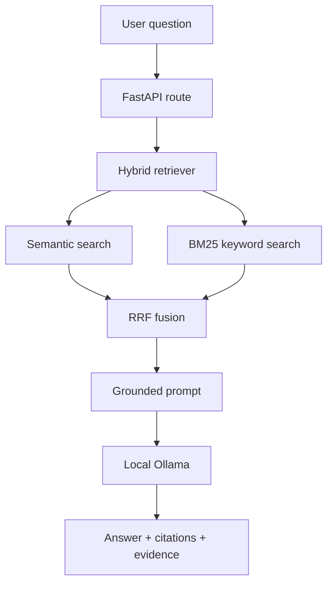

# Local Ollama RAG Tutor - FastAPI

This is one complete learning project built from your Week 1-7 documents. It runs locally: FastAPI is the waiter, Ollama is the brain, Chroma is the memory cupboard, and RAG is the rule that makes the brain read the cupboard before answering.

## 1. What you will learn

1. **LLM basics:** tokens, context, temperature, embeddings, hallucination.
2. **Reliable AI calls:** prompts, Pydantic JSON schemas, validation/retry, tools and guardrails.
3. **RAG:** loading PDF/DOCX/TXT/MD/HTML, chunking, embeddings, Chroma, top-k search, citations and grounded answers.
4. **Debugging retrieval:** semantic vs keyword search, BM25, hybrid RRF, inspection results, hit-rate@k and MRR.
5. **Evals:** eval sets from real failures, deterministic assertions, LLM-as-judge with human validation, before/after deltas per problem type.
6. **Agents:** a hand-written ReAct loop, tool design, stop conditions and budgets, short- and long-term memory, and an honest agent-versus-workflow race.
7. **FastAPI:** routes, request/response models, lifespan, dependency container and exception handling.

## 2. Child-simple mental model

- A normal LLM is a child answering from memory. It can confidently guess.
- An embedding is a meaning coordinate. Similar sentences are placed nearby.
- A chunk is one small flashcard cut from a large document.
- Chroma stores the flashcards and their coordinates.
- Retrieval finds the most relevant flashcards.
- The prompt puts those flashcards on the child's desk and says, “answer only from these.”
- Generation writes the final answer. Retrieval and generation are different failure points.

## 3. Install and open Ollama

### Windows

1. Open **Start**, search **Ollama**, and launch it. It normally runs quietly in the system tray.
2. Open PowerShell and check:

```powershell
ollama --version
ollama ls
```

3. If the background service is not running, keep this terminal open:

```powershell
ollama serve
```

4. Open a second PowerShell and download the two models:

```powershell
ollama pull qwen3:4b
ollama pull embeddinggemma
ollama run qwen3:4b
```

Type `/bye` to leave interactive chat. Test the HTTP server:

```powershell
Invoke-RestMethod http://localhost:11434/api/tags
```

If your downloaded chat model has a different name, run `ollama ls` and put that exact name in `.env`.

## 4. Start the FastAPI project

From this project folder:

```powershell
py -3.11 -m venv .venv
.\.venv\Scripts\Activate.ps1
python -m pip install --upgrade pip
pip install -r requirements.txt
Copy-Item .env.example .env
uvicorn app.main:app --reload
```

If PowerShell blocks activation, run once for the current window:

```powershell
Set-ExecutionPolicy -Scope Process -ExecutionPolicy Bypass
```

Open `http://127.0.0.1:8000/docs`. Swagger is your no-frontend testing screen.

## 5. Use the application in order

### A. Verify Ollama

Call `GET /health`. You should see `status: ok` and your local models.

### B. Upload knowledge

Call `POST /documents`, choose one or more PDF, DOCX, TXT, MD, or HTML files, and Execute. The response tells how many chunks were created.

### C. Ask a grounded question

Call `POST /ask`:

```json
{"question":"What is the refund period?","temperature":0.1}
```

You receive the answer, confidence, citations, and retrieved chunks. The `retrieved` field is intentionally visible: it is the Week 4 inspection view.

Ask something absent from the files. A good result is: `I don't know based on the uploaded documents.`

### D. Learn tool calling

Call `POST /tools/run` with either:

```json
{"question":"Calculate (15 + 5) * 3"}
```

```json
{"question":"Where is order ORD-1001?"}
```

The model only chooses a tool and arguments. Python validates and executes the action. The model never runs Python itself.

### E. Run the Week 7 agent

Open `http://127.0.0.1:8000/agent`. Enter a task, press **Run both and compare**, and read the agent's steps next to the fixed workflow's three stages.

Or call the API directly:

```json
POST /agent/run
{"task":"EMP-1001 paid for approved business travel 20 days ago and has not filed the expense claim yet. Can they still claim it?","budget":{"max_steps":6}}
```

The response contains every step (thought, tool, arguments, observation, latency, tokens), the `stop_reason`, and a grounded answer with citations. `POST /workflow/run` runs the same task as a fixed sequence, and `POST /agent/race` runs both and returns the side-by-side numbers.

For real numbers rather than one anecdote:

```powershell
.\run_week7.ps1 -Race            # 8 scenarios, 2 repeats, both approaches
.\run_week7.ps1 -Memory          # long-term memory demonstration
.\run_week7.ps1                  # offline agent tests, no Ollama needed
```

### F. Measure retrieval

Upload documents whose exact filenames match `expected_source`, edit `evaluation/sample_cases.json`, and send it to `POST /evaluate`. Results:

- **hit-rate@3:** fraction of questions where the correct document appeared in the first 3.
- **MRR:** rewards the correct document more when it appears at rank 1 than rank 3.

Change exactly one thing, such as semantic-only to hybrid search or chunk size 900 to 600, re-index into a new collection name, rerun, and compare the numbers.

## 6. End-to-end request flow



## 7. Every class, in plain English

| Class | File | One job |
|---|---|---|
| `Settings` | `config.py` | Reads safe configuration from `.env`. |
| Request/response models | `models.py` | Define and validate the JSON contract. |
| `OllamaClient` | `ollama_client.py` | Calls local chat, structured output, embeddings, and health APIs. |
| `DocumentLoader` | `document_loader.py` | Extracts text from supported files. |
| `TextChunker` | `chunker.py` | Cuts long text into overlapping flashcards. |
| `VectorStore` | `vector_store.py` | Saves and searches embeddings in persistent Chroma. |
| `KeywordRetriever` | `retrieval.py` | Finds exact words/codes using BM25. |
| `HybridRetriever` | `retrieval.py` | Combines semantic and keyword ranks using RRF. |
| `PromptBuilder` | `prompts.py` | Builds the grounded, injection-resistant prompt. |
| `IngestionService` | `services.py` | Orchestrates load → chunk → embed → store. |
| `RagService` | `services.py` | Orchestrates search → relevance check → prompt → answer. |
| `EvaluationService` | `services.py` | Calculates hit-rate@k and MRR. |
| `Calculator` | `tools.py` | Safely evaluates limited arithmetic syntax. |
| `OrderRepository` | `tools.py` | Demonstrates a real data lookup. |
| `ToolService` | `tools.py` | Lets the LLM choose; lets trusted code execute. |
| `Container` | `dependencies.py` | Builds shared objects once instead of per request. |
| `ToolRegistry` | `agent_tools.py` | Holds the agent's tools, renders the catalogue, validates and dispatches. |
| `PolicyAgent` | `agent.py` | The ReAct loop: think, act, observe, repeat, stop safely. |
| `FixedWorkflow` | `workflow.py` | The same task as three hard-coded stages, for comparison. |
| `Scratchpad` | `memory.py` | Short-term memory; compresses itself when it outgrows its budget. |
| `VectorMemory` | `memory.py` | Long-term memory; per-session facts recalled by meaning. |

## 8. Important concepts explained

### Tokens and context

Models read chunks of text called tokens. The context window is their desk size. If you dump every document onto the desk, it becomes slow and important facts may be lost. Retrieval selects only useful pages.

### Temperature, top-p, top-k

Temperature controls randomness in generated text. Use a low value such as 0-0.2 for factual RAG. Retrieval `top_k` is different: it means how many chunks to fetch.

### Embeddings and models

The chat model is a decoder that writes text. The embedding model is an encoder-like model that maps text to vectors. Use the same embedding model when indexing and querying; changing it requires a new collection/re-index.

### Chunk size and overlap

Small chunks are precise but may lose context. Large chunks preserve context but include noise. Overlap prevents a fact at a cut boundary from being split apart. Test at least two settings and measure.

### Semantic, keyword, and hybrid retrieval

Semantic search matches meaning: “annual leave” can find “vacation policy.” BM25 matches literal text and excels at IDs such as `ERR-4032`. RRF combines rankings without pretending their raw scores use the same scale.

### Retrieval failure vs generation failure

- Correct source missing from `retrieved`: retrieval failure. Improve chunking, query, metadata, embedding, BM25, fusion, reranking, or top-k.
- Correct source present but answer wrong: generation failure. Improve the prompt, context formatting, model, structured output, or answer validation.

Do not buy a bigger model to repair missing evidence.

### Prompt injection

An uploaded document may contain “ignore previous instructions.” The system prompt labels document text as untrusted data. In production also add authorization, file scanning, per-user collections, output filters, audit logs, rate limits, and size limits.

### Structured output and retry

`OllamaClient.structured()` sends a Pydantic JSON schema, validates the reply, and retries on invalid JSON. Your program should never trust free-form model output as executable arguments.

## 9. Debugging checklist

| Answers include facts about unrelated policies | `/ask.inspection.dropped_sources` | Lower `EVIDENCE_KEEP_RATIO` (fewer chunks reach the model) or `MAX_CONTEXT_CHUNKS`. |
| Every answer is slow and makes two model calls | `inspection.evidence_selected` vs `evidence_retrieved` | Too many chunks makes the model mis-cite, fail validation and retry. Keep the evidence filter on. |

| Symptom | Check | Fix |
|---|---|---|
| `ollama` not recognized | Installation/PATH | Restart terminal or reinstall Ollama. |
| Connection refused on 11434 | Ollama process | Launch Ollama or run `ollama serve`. |
| Model not found | `ollama ls` | Pull it or correct `.env`. |
| Embedding dimension mismatch | Embedding model changed | Use a new `COLLECTION_NAME` and re-upload. |
| Answers are invented | Retrieved evidence and threshold | Check `/ask.retrieved`, prompt, and `MIN_RELEVANCE`. |
| Exact error codes are missed | Keyword results | Keep hybrid BM25 + semantic retrieval. |
| Upload returns 415 | Extension | Convert to PDF/DOCX/TXT/MD/HTML. |
| First response is slow | Model cold-start | Run the model once before the API. |

## 10. Tests and experiments

Run unit tests without needing Ollama:

```powershell
pytest -q
```

Run the Week 6 HR-policy regression evals with one command:

```powershell
.\run_evals.ps1
```

This deterministic run uses frozen Week 5 failures and control cases, validates the policy-answer judge against human labels, checks free assertions first, and writes before/after scores to `evaluation/week6_results.json`.

Run the Week 7 agent-versus-workflow race:

```powershell
.\run_week7.ps1 -Race
```

Results are written to `course/results/week7_race.json`. Scenario pass conditions are declared in `course/week7_scenarios.json` before any run.

Measure the `/ask` answer-precision settings (three arms, one variable each):

```powershell
.\.venv\Scripts\python.exe -m course.ask_experiment
```

Results are written to `course/results/week7_ask_experiment.json`. The shipped defaults come
from that run: the evidence filter is on (-52% latency, -21% tokens, accuracy unchanged) and
the compact prompt is off (-15 assertion points).

Recommended learning experiments:

1. Ask the same creative question at temperatures 0 and 1; compare variation.
2. Index the same documents using 400/50 and 900/150 chunking in separate collection names.
3. Temporarily return semantic-only results, record hit-rate@3, then restore hybrid RRF and compare.
4. Put an exact code such as `ERR-4032` in a document and compare semantic vs keyword retrieval.
5. Inspect a failure and label it `retrieval` or `generation` before changing code.

## 11. Production improvements after you understand this version

- Authentication and per-user/tenant document isolation.
- Background ingestion queue for large files.
- Object storage for original documents and clickable citation URLs.
- PostgreSQL for metadata and audit history.
- Reranking with a local BGE cross-encoder after hybrid retrieval.
- Query rewriting/HyDE only after baseline evaluation proves a need.
- Streaming answers, caching, observability, rate limiting and CI/CD.
- OCR for scanned PDFs and malware/file-size controls.

Start simple, measure one change at a time, and only then add complexity.
